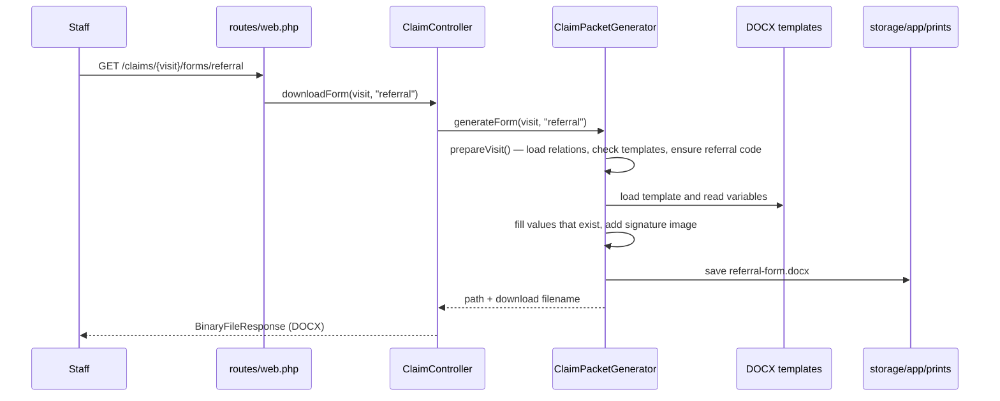
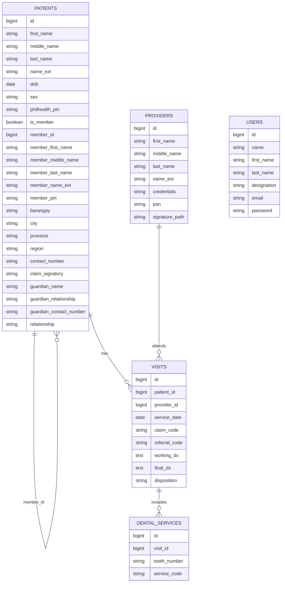

# Architecture Notes

This document describes how the application is put together, how a claim form
request flows through the system, and where to make common changes.

## Application layers

The project follows a standard Laravel structure with one domain service for claim
form generation.

| Layer | Location | Responsibility |
| --- | --- | --- |
| Routing | `routes/web.php`, `routes/auth.php` | URL definitions and authentication middleware |
| Controllers | `app/Http/Controllers` | Request validation, model loading, responses |
| Models | `app/Models` | Eloquent relationships, casts, and formatting helpers |
| Domain service | `app/Services/ClaimPacketGenerator.php` | Template loading, placeholder filling, referral codes, DOCX/PDF output |
| Views | `resources/views` | Blade screens and layout |
| Frontend | `resources/js`, `resources/css` | Alpine.js, DOCX print preview, Tailwind styles |
| Configuration | `config/claims.php` | Template paths, LibreOffice, referral prefix, visit codes, admin defaults |
| Persistence | `database/migrations`, `database/seeders` | Schema and starter data |

There is no repository layer or formal domain model beyond Eloquent. Controllers use
models directly; claim generation is isolated in the service.

## Request flow: downloading a claim form



The other endpoints follow the same path:

- `GET /claims/{visit}/forms` renders the download page.
- `GET /claims/{visit}/forms/{form}` downloads one of `referral`, `claim-1`, or
  `claim-2`.
- `GET /claims/{visit}/forms.zip` fills all three forms and adds them to a ZIP.
- `GET /claims/{visit}/print` is a legacy redirect to the forms page.

The **Print** button is client-side only: `resources/js/app.js` fetches the DOCX,
renders it into a new window with `docx-preview`, and calls `window.print()`. It does
not create a PDF on the server.

## ClaimPacketGenerator

The service is constructed from four configuration values:

| Property | Config key | Purpose |
| --- | --- | --- |
| `templatePath` | `claims.templates_path` | Source DOCX directory |
| `printsPath` | `claims.prints_path` | Output directory |
| `libreOfficeBinary` | `claims.libreoffice_binary` | PDF converter command |
| `referralPrefix` | `claims.referral_prefix` | Referral code prefix |

### Public methods

| Method | Result |
| --- | --- |
| `generate(Visit $visit): string` | Fills all three forms, converts them to PDF, merges them, and returns the PDF path |
| `generateForm(Visit $visit, string $form): array` | Fills one form and returns `['path' => ..., 'filename' => ...]` |
| `generateFormsArchive(Visit $visit): array` | Fills all three DOCX files and returns a ZIP path and filename |
| `ensureReferralCode(Visit $visit): string` | Allocates and persists a referral code if the visit does not have one |

`generate()` is not exposed through a route. It is available for a future PDF
download endpoint, a console command, or queued generation. It writes to
`storage/app/prints/claim-packet-{code}.pdf`.

### Preparation

Every public generation method calls `prepareVisit()`, which:

1. Eager-loads `patient.member`, `provider`, and `dentalServices`.
2. Throws if the visit has no patient or provider.
3. Verifies that all three template files exist.
4. Ensures the visit has a referral code.

This makes form generation independent of how the visit was created.

### Filling mechanics

1. `loadTemplate()` opens the DOCX with PHPWord's `TemplateProcessor`.
2. PHPWord's macro delimiters are static, so the service performs a throw-away load
   to set `{{` and `}}` before loading the real template. The temporary document is
   removed immediately.
3. `setValuesIfPresent()` reads `getVariables()` and only calls `setValue()` for
   placeholders that actually exist. A simplified template can omit fields without
   causing errors.
4. Checkbox placeholders receive `☑` or `☐`.
5. Signature placeholders receive an image when the provider has a resolvable
   `signature_path`.
6. Claim Form 2 clones the `tooth_number` row once per dental service.

See [template-placeholders.md](template-placeholders.md) for the full placeholder
list and formatting rules.

### Signature path resolution

`signature_path` is resolved against these locations, in order:

1. The path exactly as stored (absolute paths work).
2. `storage/app/{path}`
3. `storage/app/public/{path}`
4. `public/{path}`

The first readable file wins. The form is still generated without a signature if
none resolves.

### PDF conversion and merging

`generate()` creates a temporary working directory under
`storage/app/tmp/claims/{visit-id}-{uuid}` and converts each filled DOCX with:

```text
soffice -env:UserInstallation=file:///{tmp}/libreoffice-profile
        --headless --convert-to pdf --outdir {tmp} {docx}
```

A per-conversion LibreOffice profile avoids locking conflicts with a desktop
session. The resulting PDFs are merged in print order with `iio/libmergepdf`, and
the temporary directory is always deleted in a `finally` block.

Annex E page 3 (the CSF) is filled by a separate system, so it is intentionally not
part of this packet. The packet contains the referral form and Annex E pages 1 and
2 only.

## Referral codes

Referral codes use the format:

```text
{prefix}-{MMDDYYYY}-{NN}
```

Example: `CHO-10242026-01`.

Allocation logic in `ensureReferralCode()`:

1. Return the existing code if the visit already has one.
2. Otherwise, use the visit's `service_date` (falling back to `created_at`, then
   now).
3. Count visits on the same date, excluding the current visit, and add one.
4. Build the code and increment the sequence until it is unique for that date.
5. Save the code on the visit.

The code is persisted, so reprinting an older visit never allocates a new number.
The count-and-check sequence is not wrapped in a database transaction; two requests
generating forms for the same date at exactly the same time could race. For a
single-clinic deployment this is normally acceptable.

## Data model



Key behavior:

- `patients.member_id` is a self-reference. A dependent points to the member
  patient; `member_id` is `null` for members.
- Dependents can also store manual member details in `member_first_name`,
  `member_middle_name`, `member_last_name`, `member_name_ext`, and `member_pin`.
  This covers members who are not registered as patients. Claim Form 1 uses the
  linked member when available, otherwise the manual member profile.
- `patients.is_member` controls which fields are filled on Claim Form 1: the member
  becomes Part I, and dependent data fills Part II.
- `patients.claim_signatory` selects whose name appears on the Claim Form 2
  signature line. The selector is available for every patient so staff can
  choose `patient` when no guardian is involved. `guardian` is only accepted
  when the patient is aged 13 or below; otherwise the patient is used. Guardian
  details live in `guardian_name`, `guardian_relationship`, and
  `guardian_contact_number`.
- `visits.patient_id` cascades on delete, while `visits.provider_id` restricts
  deletion. A provider with visits cannot be deleted until those visits are removed.
- `visits.claim_code` records the PhilHealth dental claim code. The `OPH01` series
  (`OPH01`, `OPH01A`, `OPH01B`) is the first service of the year and the `OPH02`
  series (`OPH02`, `OPH02A`, `OPH02B`) is the second. The code list and service
  numbers live in `claims.visit_codes`.
- The yearly benefit status is derived from visits in the current calendar year.
  `Patient::visitsThisYear()` filters `visits` by `service_date`; the Patients list
  shows the count and first visit date, and the detail page shows the next
  suggested service. A previous-year visit does not count toward the current year.
- `dental_services.visit_id` cascades on delete.
- `patients.philhealth_pin` is normalized by the model mutator to
  `99-999999999-9` when 12 digits are supplied. `Patient::philhealthPin()` also
  formats legacy raw values for display.
- `users` store both a display `name` and structured `first_name`, `last_name`, and
  `designation` fields. The encoder fields on the referral form come from the
  authenticated user.

## Storage layout

```text
storage/app/
  templates/
    Referral_Form System.docx
    PhilHealth_Claim_Form_1 System.docx
    PhilHealth_Claim_Form_2 System.docx
    *.bak-YYYYMMDDHHMMSS          (created when a template is replaced)
  prints/
    docx/{referral-code}/
      referral-form.docx
      claim-form-1.docx
      claim-form-2.docx
      Claim-Forms-{name-or-code}.zip
    claim-packet-{referral-code}.pdf   (only from generate())
  tmp/claims/{visit-id}-{uuid}/        (deleted after generate())
```

`storage/app/templates` is intentionally tracked by Git; generated output under
`prints/` and `tmp/` is ignored. Generated files are not cleaned up automatically.

## Configuration

`config/claims.php` is the single place for claim-specific settings. The values can
be overridden with the environment variables listed in the README.

Two details worth knowing:

- `claims.encoder_designation` is defined but not currently read by
  `ClaimPacketGenerator`. The encoder designation uses the signed-in user's
  `designation` and falls back to `claims.provider_designation`. Use
  `CLAIM_PROVIDER_DESIGNATION` when changing the fallback.
- `claims.encoder_name` is only a fallback when no user is authenticated. Normal web
  requests always use the signed-in user's name.

## Extending the application

### Visit entry and yearly status

`VisitController` records additional services:

- `GET /patients/{patient}/visits/create` — form; preselects the next claim code
  from the patient's visits this year.
- `POST /patients/{patient}/visits` — validates the date, provider, and claim code,
  then redirects to the patient detail page.
- `GET /visits/{visit}/edit` and `PUT /visits/{visit}` — correct an existing visit,
  including its claim code.

`PatientController::store()` still creates the first visit automatically and tags it
`OPH01`. `Visit::claimCodes()` and `Visit::visitNumberForCode()` read the code list
from `claims.visit_codes`. `Patient::visitsThisYear()` drives the 1st/2nd service
labels in the patient list and detail page.

Not implemented yet: deleting an existing visit, and UI for `dental_services`
(`tooth_number` / `service_code`). Add those before relying on Claim Form 2's
service rows. Keep the visit's `referral_code` immutable once assigned.

### Expose PDF generation

Add an authenticated route and controller action:

```php
Route::get('/claims/{visit}/packet.pdf', [ClaimController::class, 'packet'])
    ->name('claims.packet');

public function packet(int $visit_id): BinaryFileResponse
{
    $path = $this->claimPacketGenerator->generate($this->findVisit($visit_id));

    return response()->download($path, basename($path), [
        'Content-Type' => 'application/pdf',
    ]);
}
```

Ensure LibreOffice is installed and `LIBREOFFICE_BINARY` is set before exposing this
route. PDF conversion is synchronous and can take several seconds per packet; for
larger deployments consider a queued job.

### Add roles and permissions

The application currently gives every authenticated user access to every screen.
Add Laravel policies or a package such as Spatie Permission, then protect the
`users`, `templates`, and destructive routes first. Also disable public registration
in `routes/auth.php` if accounts should be administrator-created only.

## Known gaps and cleanup candidates

- The bundled Claim Form 2 template only contains the name and date placeholders;
  diagnosis, disposition, and dental-service placeholders need to be added to the
  DOCX to take effect.
- There is no visit CRUD screen.
- `generate()` (PDF + merge) has no route.
- Public registration is enabled by default and there are no roles.
- `claims.encoder_designation` is unused.
- Referral code allocation is not transactional.

## Tests

The suite uses PHPUnit with an in-memory SQLite database (`phpunit.xml`).

```bash
php artisan test
```

Coverage highlights:

- `tests/Feature/CrudTest.php` exercises patient/member linking, provider and user
  CRUD, dental aides, and claim form downloads. It inspects the filled DOCX XML to
  confirm the encoder name and designation are inserted.
- `tests/Feature/Auth` covers Breeze authentication flows.
- `tests/Feature/ProfileTest.php` covers profile updates and account deletion.

The claim form test relies on the real templates in `storage/app/templates` and the
`zip` PHP extension. Run the suite after replacing templates to catch missing files.

## Conventions

- Follow PSR-12 and Laravel conventions; format with `vendor/bin/pint`.
- Keep claim-specific configuration in `config/claims.php`, not inline in the
  service.
- Add or update tests when changing form generation behavior.
- Update the [template reference](template-placeholders.md) whenever placeholder
  names or value formats change.
